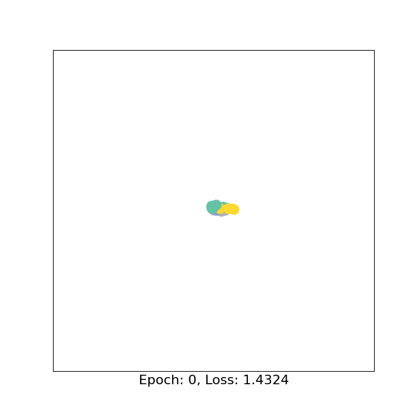

# Karate Club GNN 튜토리얼과 W&B Sweep

PyTorch와 PyTorch Geometric(PyG)으로 Karate Club 그래프의 노드 분류를 실습합니다. 입문 노트북, YAML 기반 학습, W&B 하이퍼파라미터 탐색, 선택한 설정의 재학습·평가로 구성됩니다. 현재 코드와 설정을 기준으로 2026-10-15에 점검했습니다.

## 파일 구성

| 파일 | 역할 |
| --- | --- |
| [Karate_club_gcn_tutorial.ipynb](./Karate_club_gcn_tutorial.ipynb) | 데이터 탐색, 2차원 임베딩, 학습, 미학습 노드 평가, GIF 생성 |
| [wandb_sweep_Karate_club_gnn.py](./wandb_sweep_Karate_club_gnn.py) | GCN·GAT·GraphSAGE 단일 학습과 W&B Sweep |
| [Karate_club_gnn_sweep_validation.ipynb](./Karate_club_gnn_sweep_validation.ipynb) | 선택한 Sweep 설정으로 재학습하고 미학습 노드를 평가 |
| [utils/model.py](./utils/model.py) | GCN, GAT, GraphSAGE 모델 |
| [utils/wandb.py](./utils/wandb.py) | YAML 로드, Sweep 설정 적용, 실행 이름 및 체크포인트 경로 처리 |
| [configs/config.yaml](./configs/config.yaml) | 최적화, 학습, 로그 및 체크포인트 기본 설정 |
| [configs/gnn_model_config.yaml](./configs/gnn_model_config.yaml) | 모델 기본 설정 |
| [configs/sweeps/gcn_config.yaml](./configs/sweeps/gcn_config.yaml), [gat_config.yaml](./configs/sweeps/gat_config.yaml), [graphsage_config.yaml](./configs/sweeps/graphsage_config.yaml) | 모델별 Sweep 명령과 탐색 범위 |
| [requirements-sweep.txt](./requirements-sweep.txt) | 학습 및 Sweep 의존성 |
| [launch_gnn.sh](./launch_gnn.sh), [launch_sweep.sh](./launch_sweep.sh) | Bash 실행 도우미 |
| [wanb_sweeps.md](./wanb_sweeps.md) | 상세 Sweep 실행 안내 |
| [loss_curve_vis/loss_curve_comp.ipynb](./loss_curve_vis/loss_curve_comp.ipynb) | 기본 GCN·튜닝 GCN 및 GAT·GraphSAGE 학습 손실 비교 |

기존 `Karate_club_gcn.ipynb`는 `Karate_club_gcn_tutorial.ipynb`로 이름이 변경되었습니다. 현재 공통 스크립트는 `wandb_sweep_Karate_club_gnn.py`, 모델 설정은 `configs/gnn_model_config.yaml`, 재학습 노트북은 `Karate_club_gnn_sweep_validation.ipynb`입니다.

## 데이터와 학습 목표

`torch_geometric.datasets.KarateClub()`으로 데이터를 불러오며 별도 데이터 파일은 필요하지 않습니다.

| 항목 | 값 / 설명 |
| --- | --- |
| 그래프 / 노드 수 | 1개 / 34명 |
| 무방향 연결 수 | 78개 |
| `data.edge_index` | `[2, 156]`; 각 연결을 양방향으로 저장 |
| `data.x` | `[34, 34]`; 노드별 원-핫 특징 |
| `data.y` | `[34]`; 0~3의 커뮤니티 레이블 |
| `data.train_mask` | `[34]`; 클래스당 1개, 총 4개 학습 노드 |
| 평가 노드 | `~data.train_mask`; 나머지 30개 노드 |

전체 그래프의 특징과 연결을 사용하지만 손실에는 4개 노드의 레이블만 사용합니다. 이미 주어진 그래프의 나머지 노드를 분류하는 반지도·전이적(transductive) 학습입니다. 학습 목표는 PyG의 `Data`와 `edge_index`, `GCNConv`, 마스크 기반 손실, 임베딩 시각화, 하이퍼파라미터 탐색과 평가를 이해하는 것입니다.

## 실행 환경 준비

입문·재학습 노트북의 메타데이터에는 Python `3.10.21`, 커널 표시 이름 `ai_tutorial`이 기록되어 있습니다. 의존성 버전은 고정되어 있지 않습니다. 프로젝트 루트에서 실행하세요.

```powershell
conda create -n ai_tutorial python=3.10 -y
conda activate ai_tutorial
python -m pip install -r requirements-sweep.txt
python -m pip install jupyterlab ipykernel ipywidgets
python -m ipykernel install --user --name ai_tutorial --display-name ai_tutorial
```

기존 환경이 있으면 생성 단계는 생략합니다. requirements에는 `torch`, `torch-geometric`, `wandb`, `PyYAML`, `matplotlib`, `networkx`, `pillow`, `numpy`가 포함되며 Jupyter 도구는 별도 설치합니다. 추가 확장 설치는 [PyG 공식 설치 안내](https://pytorch-geometric.readthedocs.io/en/latest/install/installation.html)를 참고하세요. 현재 모델과 데이터를 GPU로 이동하는 코드는 없어 CPU에서 학습합니다.

## 입문 노트북 실행

`python -m jupyterlab`으로 `Karate_club_gcn_tutorial.ipynb`를 열고 `ai_tutorial` 커널에서 위에서 아래로 실행합니다. VS Code에서도 같은 Python 환경을 선택한 뒤 Run All을 사용할 수 있습니다.

```text
노드 특징 [34, 34] + 그래프 연결 [2, 156]
    → GCNConv(34, 4) → ReLU
    → GCNConv(4, 4)  → ReLU
    → GCNConv(4, 2)  → ReLU
    → 임베딩 h [34, 2] → Linear(2, 4) → 로짓 out [34, 4]
```

`forward()`는 로짓과 임베딩을 반환합니다. 학습은 `CrossEntropyLoss`, Adam(`lr=0.01`), `range(500)`으로 0~499의 500회 업데이트를 수행합니다.

```python
out, h = model(data.x, data.edge_index)
loss = criterion(out[data.train_mask], data.y[data.train_mask])
```

학습 후 `model.eval()`에서 나머지 30개 노드의 손실과 정확도를 계산합니다. 별도의 검증 분할은 없습니다. 평가 노드의 결과를 반복적으로 확인하며 설정을 선택하면 독립적인 최종 평가로 해석하기 어렵습니다.

### 임베딩 애니메이션

매 epoch의 임베딩, epoch 번호, 손실을 기록합니다. 임베딩은 해당 업데이트 전 순전파 결과이며 산점도 색은 정답 레이블입니다. 저장된 좌표를 재생하므로 애니메이션 생성 중에는 추가 학습하지 않습니다.

| 항목 | 현재 설정 |
| --- | --- |
| 기록 수 | 500프레임 |
| 재생 속도 | `fps=50`; 명목상 한 번 재생에 10초 |
| 프레임 간격 | `interval=1000 / fps`; 20ms |
| 저장 위치 | `results/karate_club_embedding.gif` |
| 저장 크기 | `figsize=(7, 7)`, `dpi=100`; 700 × 700px |
| 노트북 표시 | `ani.to_jshtml(fps=fps)` 재생 컨트롤 |



현재 GIF는 실행 당시의 결과이며 재학습 결과는 초기화와 환경에 따라 달라질 수 있습니다. 노트북에 남아 있는 설명과 코드 차이는 다음과 같습니다.

- 실제 활성화는 ReLU이지만 일부 설명·애니메이션 주석은 `tanh`를 언급합니다. ReLU 좌표는 `[-1, 1]`로 제한되지 않아 고정 축 `[-1.1, 1.1]` 밖의 점이 잘릴 수 있습니다. 필요하면 전체 기록의 최솟값·최댓값으로 축을 조정하세요.
- `fps=50` 옆에는 과거 4fps 주석이 남아 있습니다. 실제 설정은 50fps입니다.
- 입문 노트북의 `seed_everything(42)`는 `torch.manual_seed()`를 호출하지 않아 CPU 초기화를 고정하지 않습니다. 동일 초기화가 필요하면 모델 생성 전에 호출하세요. 그래프 배치는 `nx.spring_layout(..., seed=42)`입니다.
- GIF 저장 전에 `results` 폴더가 필요합니다. 없으면 `save_path.parent.mkdir(parents=True, exist_ok=True)`를 저장 호출 앞에 추가하세요.

## YAML 기반 단일 학습

```powershell
python wandb_sweep_Karate_club_gnn.py
python wandb_sweep_Karate_club_gnn.py --wandb --wandb_mode offline
# 온라인 기록: 최초 로그인 후 실행
wandb login
python wandb_sweep_Karate_club_gnn.py --wandb --wandb_entity kjsong
```

`--model_type GCN`, `GAT`, `GraphSAGE`를 지원합니다. 세 모델은 모든 합성곱 계층에 같은 hidden 차원, ReLU와 dropout을 적용하고 로짓만 반환합니다. GAT는 `concat=False`로 attention head를 결합하고 GraphSAGE는 `aggr`로 이웃 집계 방법을 선택합니다. 입문 노트북의 2차원 임베딩 모델과 구조가 다릅니다.

| 모델 | 기본 hidden 차원 | 계층 수 | dropout | 추가 설정 |
| --- | --- | --- | --- | --- |
| GCN | 32 | 2 | 0.1 | — |
| GAT | 512 | 3 | 0.1 | `heads=4` |
| GraphSAGE | 512 | 3 | 0.1 | `aggr="mean"` |

| 항목 | 기본 설정 |
| --- | --- |
| GCN 계층 수 / hidden 차원 / dropout | 2 / 32 / 0.1 |
| Adam 학습률 / weight decay | `0.003` / `0.01` |
| Adam betas / epsilon | `(0.9, 0.999)` / `1e-8` |
| 최대 epoch / patience | 500 / 80 |
| Gradient clipping | norm 방식, `1.0` |
| 기본 seed | CLI `--seed=0` |
| 최적화 지표 | `best_train_loss` 최소화 |

업데이트 후 `model.eval()`에서 학습 노드 4개의 손실이 개선될 때 `best.pt`를 저장하고 80 epoch 연속 개선이 없으면 종료합니다. W&B에는 매 epoch `loss`(업데이트 전), `train_loss`, `train_accuracy`, `best_train_loss`를 기록합니다. 스크립트에는 미학습 노드 평가와 GIF 생성이 없습니다.

`configs/config.yaml`의 로그·체크포인트 경로는 현재 KETI PC의 절대 경로입니다. 다른 PC에서는 먼저 `logging_dir: "logs"`, `checkpoint_dir: "checkpoints"` 등으로 변경하세요.

- W&B 없이 실행하면 기본 체크포인트 디렉터리의 `best.pt`를 사용해 이전 파일을 덮어쓸 수 있습니다.
- W&B 실행 시 기본 이름은 `<MODEL>-<run_id>`이고 경로는 `checkpoints/<MODEL>-<run_id>-<run_id>/best.pt`입니다. `<MODEL>`은 `GCN`, `GAT`, `GraphSAGE` 중 선택한 모델입니다. `--wandb_run_name NAME`이면 `checkpoints/NAME-<run_id>/best.pt`입니다.
- W&B 실행 로그는 `logging_dir` 아래 `wandb/`에 저장됩니다. Sweep agent 설정 파일은 프로젝트 루트의 `wandb/`에도 생성될 수 있습니다.

YAML의 `max_global_samples`, `global_batch_size`, `score_alpha`, `accumulate_grad_batches`, `log_every_n_steps`, `log_every_n_samples`, `val_*`, `throughput_enabled`, `log_normalized_violation`은 현재 학습 루프에서 사용하지 않습니다. `checkpointing.monitor`, `save_last`, 저장 주기 설정도 반영되지 않으며 개선 시 `best.pt`만 저장합니다. `checkpointing.run_scoped`는 경로 처리에 사용되고 생략 시 `true`입니다. 현재 모델 YAML의 GCN·GAT·GraphSAGE 설정은 해당 `--model_type` 선택 시 사용됩니다.

## W&B Sweep과 설정 재평가

```powershell
python -m wandb sweep --entity kjsong --project karate-club-gcn-sweep configs/sweeps/gcn_config.yaml
# 출력된 실제 SWEEP_ID로 교체
python -m wandb agent --count 1 kjsong/karate-club-gcn-sweep/SWEEP_ID
```

현재 Sweep은 Bayesian 탐색으로 학습 손실을 최소화합니다. Windows에서 Python을 직접 실행하므로 Bash는 필요하지 않습니다. 탐색 범위와 Hyperband, 평가 노트북 사용법은 [Sweep 안내](./wanb_sweeps.md)를 참고하세요.

`Karate_club_gnn_sweep_validation.ipynb`는 선택한 로컬 W&B YAML을 읽고 모델을 새로 초기화해 500 epoch 재학습합니다. 첫 설정 셀의 `path`를 실제 파일로 변경해야 합니다. 현재 GraphSAGE가 선택되어 있으며, GCN·GAT를 평가하려면 설정 파일 경로와 모델 생성 셀의 주석을 함께 전환하세요. `best.pt`를 복원하지 않으며 seed는 42(스크립트 기본값은 0), gradient clip 값은 반올림 없이 사용합니다. patience 없이 500 epoch를 학습하고 `loss_history`에 업데이트 전 학습 손실을 기록합니다. 따라서 기존 Sweep 가중치나 결과를 그대로 재현하는 과정은 아닙니다.

## 손실 곡선 비교

[loss_curve_vis/loss_curve_comp.ipynb](./loss_curve_vis/loss_curve_comp.ipynb)는 저장된 NumPy 배열로 기본 GCN과 튜닝 GCN, 튜닝한 GCN·GAT·GraphSAGE의 학습 손실을 비교합니다.

```powershell
conda activate ai_tutorial
Set-Location loss_curve_vis
python -m jupyterlab
```

노트북은 `./data/`를 상대 경로로 읽으므로 커널의 작업 디렉터리를 `loss_curve_vis`로 맞추세요. `data/`의 `gcn_train_loss_basic.npy`, `gcn_train_loss_hpt.npy`, `gat_train_loss_hpt.npy`, `graphsage_train_loss_hpt.npy`가 필요하며 현재 각 배열에는 500 epoch의 기록이 있습니다. 비교 노트북은 파일명에 따라 기본·튜닝 모델의 기록으로 표시합니다. 배열 자체에는 seed나 설정 메타데이터가 없으므로 엄밀한 동일 조건 비교로 해석하지 마세요.

두 학습 노트북의 `np.save` 예제는 현재 주석 처리되어 있습니다. 새 곡선을 저장하려면 NumPy import와 저장 코드를 활성화하고 실제 대상 경로를 `loss_curve_vis/data/` 아래로 지정하세요. 저장된 비교 데이터는 저장소에 포함되며 자동 갱신되지 않습니다.

## 실행 시 참고

- 모듈을 찾지 못하면 설치한 Python과 노트북 커널이 같은 환경인지 확인하세요.
- `IProgress not found` 경고에는 같은 환경에 `ipywidgets`를 설치하고 커널을 재시작하세요.
- GIF 저장에는 Pillow가 필요하며 FFmpeg는 필요하지 않습니다.
- HTML 애니메이션으로 노트북 크기가 커질 수 있습니다. 기록 주기를 늘리거나 그림 크기를 줄이면 출력 크기를 줄일 수 있습니다.
- `logs/`, `wandb/`, `checkpoints/`, Python 캐시는 `.gitignore`로 제외됩니다. 검증 노트북이 참조하는 개인 Sweep 설정 파일은 저장소에 포함되지 않습니다.

## 참고 자료

- [PyTorch Geometric 설치 안내](https://pytorch-geometric.readthedocs.io/en/latest/install/installation.html)
- [KarateClub 데이터셋 문서](https://pytorch-geometric.readthedocs.io/en/latest/generated/torch_geometric.datasets.KarateClub.html)
- [GCNConv 문서](https://pytorch-geometric.readthedocs.io/en/latest/generated/torch_geometric.nn.conv.GCNConv.html)
- [Matplotlib 애니메이션 안내](https://matplotlib.org/stable/users/explain/animations/animations.html)
- [W&B Sweep 설정 안내](https://docs.wandb.ai/models/sweeps/define-sweep-configuration)
- [Kipf & Welling, Semi-Supervised Classification with Graph Convolutional Networks](https://arxiv.org/abs/1609.02907)
